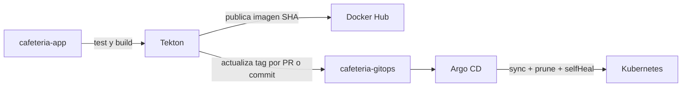

# Cafetería en línea — GitOps

Estado deseado de Kubernetes, configuración de Argo CD y recursos de
observabilidad para la cafetería en línea. Este repositorio describe qué debe
existir en el clúster; no contiene el código fuente de los microservicios.

> **Estado actual:** estructura y diseño documentados. Todavía no existen
> manifiestos aplicables al clúster.

## Repositorios

| Repositorio | Responsabilidad |
|---|---|
| [`cafeteria-app`](https://github.com/Migue98/cafeteria-app) | Código, pruebas, contratos, imágenes y pipelines de Tekton. |
| [`cafeteria-gitops`](https://github.com/Migue98/cafeteria-gitops) | Kubernetes, overlays, Argo CD y observabilidad. |

## Equipo

| Integrante | GitHub |
|---|---|
| Miguel Alberto Bazán Silva | [`@Migue98`](https://github.com/Migue98) |
| González Nava Alicia Aislinn | [`@aliceaislinn`](https://github.com/aliceaislinn) |
| Quintero Rubio Martín | Pendiente de confirmar |

Las responsabilidades concretas se asignarán mediante Issues y Pull Requests.

## Flujo GitOps



- Tekton construye y publica imágenes; no ejecuta `kubectl apply`.
- Este repositorio referencia imágenes inmutables por SHA, nunca `latest`.
- Argo CD es el único componente que sincroniza el estado con Kubernetes.
- Los cambios manuales en el clúster se consideran deriva y Argo CD debe corregirlos.

## Estructura

```text
.
├── apps/                  # Applications de Argo CD
├── argocd/                # Bootstrap y app-of-apps opcional
├── base/                  # Recursos comunes por componente
│   ├── frontend/
│   ├── svc-menu/
│   ├── svc-pedidos/
│   ├── svc-lealtad/
│   └── postgres/
├── overlays/
│   ├── staging/           # Variantes de preproducción
│   └── production/        # Variantes de producción
├── monitoring/            # ServiceMonitors, alertas y dashboards
└── docs/                  # Infraestructura y observabilidad
```

Los manifiestos de aplicación se organizarán con Kustomize. Cada base tendrá
Deployment o StatefulSet, Service, configuración no sensible, probes, recursos
y etiquetas comunes. Las diferencias entre ambientes vivirán únicamente en
los overlays.

## Ambientes

| Ambiente | Propósito | Política esperada |
|---|---|---|
| `staging` | Validar una imagen antes de la demostración. | Sincronización automática. |
| `production` | Entorno estable de la presentación. | Imágenes promovidas y cambios revisados. |

Los namespaces previstos son `tienda`, `monitoring`, `tekton-pipelines` y `argocd`.

## Secretos

No se versionarán Secrets reales, kubeconfigs, tokens, llaves privadas,
inventarios con IP internas ni archivos `.env`. Durante el MVP los valores
sensibles se crearán fuera de Git; posteriormente puede adoptarse Sealed
Secrets. Los ejemplos deben usar valores ficticios claramente identificados.

## Forma de trabajo

1. Abrir un Issue y documentar el cambio deseado y su impacto.
2. Crear una rama `ops/...`, `fix/...` o `docs/...` desde `main`.
3. Renderizar y validar Kustomize antes de abrir el Pull Request.
4. Incluir evidencia de la validación y solicitar al menos una revisión.
5. Integrar a `main` y verificar el estado de sincronización en Argo CD.

No se deben aplicar manualmente los manifiestos de este repositorio como parte
del flujo normal. Consulta [CONTRIBUTING.md](CONTRIBUTING.md).

## Documentación

- [Infraestructura propuesta](docs/infrastructure.md)
- [Observabilidad](docs/observability.md)
- [Arquitectura general](https://github.com/Migue98/cafeteria-app/blob/main/docs/architecture.md)
- [Plan de implementación](https://github.com/Migue98/cafeteria-app/blob/main/docs/implementation-plan.md)

## Siguiente hito

Crear las bases Kustomize de los cuatro microservicios y PostgreSQL después de
que exista la primera imagen ejecutable de `svc-menu`.
